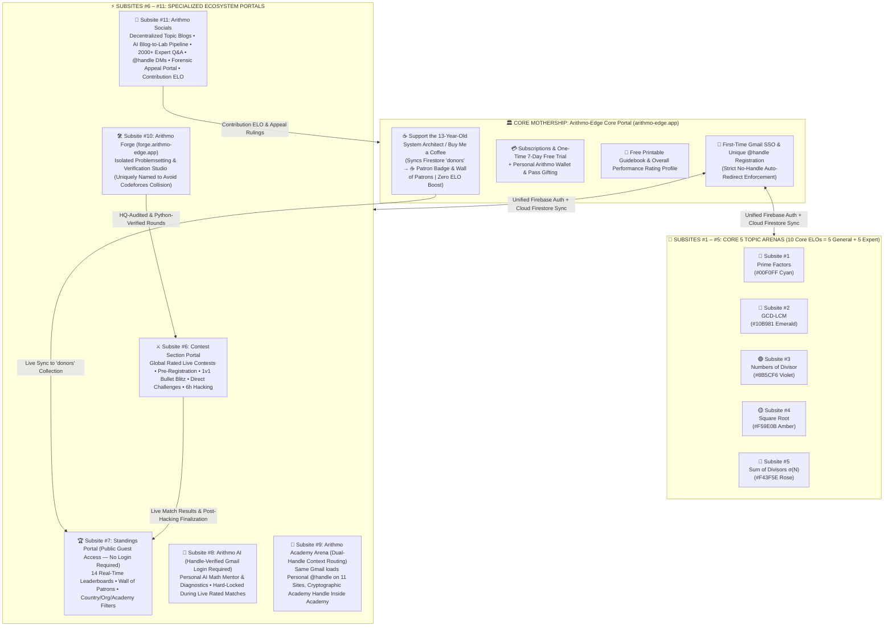
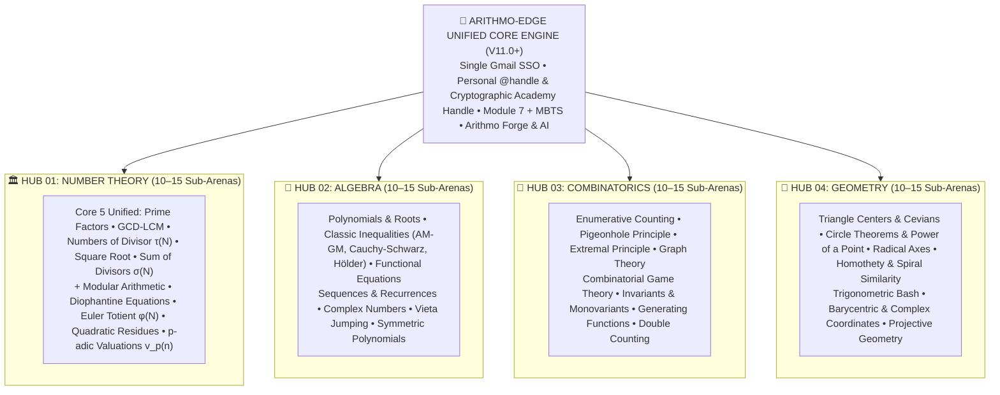

<div align="center">


# 🌌 Prime-Factor.app $\rightarrow$ **Arithmo-Edge**
### *The World's First Real-Time ELO-Rated Competitive Mathematics & Olympiad Mega-Ecosystem — Powered by Olympiad Edge*

[](https://github.com/rayaantasnim/Prime-Factorization-Web)
[](https://arithmo-edge.app)
[](https://firebase.google.com)
[](https://ai.google.dev)
[](#dropdown-6-arithmo-forge-subsite-10-5-pillar-legal-problem-generation--zero-fp-anti-cheat)
[](https://vercel.com)

</div>

---

## 🏛️ 1. The 12-Site Unified Architecture (1 Core Portal + 11 Subsites)

<div align="center">

</div>

<br/>

**Arithmo-Edge** operates as a **12-Website Federated Competitive Mathematics Mega-Ecosystem** unified under **one single Firebase Project** (`Firebase Auth` + `Cloud Firestore`). Every subsite shares the exact same authentication state, ELO ledger, telemetry vault, and wallet—enforced by a **Strict No-Handle Auto-Redirect Gate**:

> **🔐 Strict No-Handle Auto-Redirect Protocol:**  
> Every competitor MUST first authenticate via Google OAuth 2.0 (Gmail SSO) on the **Arithmo-Edge Core Portal** to claim their globally unique `@handle`. If a user attempts to sign into any of Subsites `#1–#11` with a Gmail account that lacks a registered `@handle` in Firestore, the client SDK immediately intercepts the session and auto-redirects them back to the **Core Portal `@handle` Onboarding Gate**.

### 🌐 A. 12-Site Federated Ecosystem Blueprint (`Mermaid.js`)



---

### 🧩 B. Complete 12-Website Directory & Functional Breakdown

| Site ID | Portal Name & Domain | Core Responsibilities & Architectural Rules |
| :---: | :--- | :--- |
| **Core** | **Arithmo-Edge Core Portal**<br>`arithmo-edge.app` | • **First-Time Gmail SSO & `@handle` Registration:** Mandatory entry point; enforces Strict No-Handle Auto-Redirect across all 11 subsites.<br>• **Subscriptions & 7-Day One-Time Free Trial:** Manages Free, Plus, Pro, Premium, Singularity, and Academy tiers.<br>• **Personal Arithmo Wallet:** Holds top-up credits, micro-passes, `@handle` pass gifts, and `Contribution ELO` milestone rewards.<br>• **Free Printable Guidebook & Overall Rating:** Hosts the printable master handbook and displays the user's unified **Overall Performance Rating** profile.<br>• **☕ Support the 13-Year-Old System Architect / Buy Me a Coffee:** Dedicated donation portal syncing donors in real time to the Firestore `donors` collection, unlocking a prestigious `☕ Patron` profile badge and placement on the public **Wall of Patrons** on Standings—with **strictly zero ELO or competitive advantage**. |
| **#1** | **Prime Factors Arena**<br>`prime.arithmo-edge.app` | • **Signature Theme:** Fixed **Electric Cyan (`#00F0FF`)** dark neon UI *(strictly no light/dark theme toggle on any arena)*.<br>• **Features:** Unrated Practice, **Virtual Gym**, topic **Problemset**, and Dual Core ELOs (`General ELO` + `Expert ELO`). |
| **#2** | **GCD-LCM Arena**<br>`gcd.arithmo-edge.app` | • **Signature Theme:** Fixed **Mint Emerald (`#10B981`)** dark neon UI.<br>• **Features:** Unrated Practice, **Virtual Gym**, topic **Problemset**, and Dual Core ELOs (`General ELO` + `Expert ELO`). |
| **#3** | **Numbers of Divisor Arena**<br>`tau.arithmo-edge.app` | • **Signature Theme:** Fixed **Vibrant Violet (`#8B5CF6`)** dark neon UI.<br>• **Features:** Unrated Practice, **Virtual Gym**, topic **Problemset**, and Dual Core ELOs (`General ELO` + `Expert ELO`). |
| **#4** | **Square Root Arena**<br>`sqrt.arithmo-edge.app` | • **Signature Theme:** Fixed **Laser Amber (`#F59E0B`)** dark neon UI.<br>• **Features:** Unrated Practice, **Virtual Gym**, topic **Problemset**, and Dual Core ELOs (`General ELO` + `Expert ELO`). |
| **#5** | **Sum of Divisors $\sigma(N)$ Arena**<br>`sigma.arithmo-edge.app` | • **Signature Theme:** Fixed **Nebula Rose (`#F43F5E`)** dark neon UI.<br>• **Features:** Unrated Practice, **Virtual Gym**, topic **Problemset**, and Dual Core ELOs (`General ELO` + `Expert ELO`). *(Total across Subsites #1–#5 = **10 Core ELOs**).* |
| **#6** | **Contest Section Portal**<br>`contests.arithmo-edge.app` | • Houses all global rated live contests, pre-registrations, 4-segment contract cards, **1v1 Bullet Blitz**, **Direct Friend Challenges**, and **6-Hour Post-Contest Hacking**. |
| **#7** | **Standings Portal**<br>`standings.arithmo-edge.app` | • **Publicly viewable without login** (just like Codeforces), housing **14 Real-Time Leaderboards**, Country/Organization/Academy filters, and the **Wall of Patrons**. |
| **#8** | **Arithmo AI**<br>`ai.arithmo-edge.app` | • Dedicated AI Math Mentor & Diagnostics subsite; requires handle-verified Gmail login and is **hard-locked during live rated matches**. |
| **#9** | **Arithmo Academy Arena**<br>`academy.arithmo-edge.app` | • Isolated institutional subsite for schools, colleges, and math clubs powered by **Dual-Handle Context Routing**: the same Gmail loads the user's personal `@handle` across the other 11 sites, while automatically loading the institution's **Cryptographic Academy Handle** inside Academy Arena. |
| **#10** | **Arithmo Forge**<br>`forge.arithmo-edge.app` | • Isolated problemsetting & verification studio—uniquely branded **Arithmo Forge** to avoid any naming collision with Codeforces Polygon. |
| **#11** | **Arithmo Socials**<br>`socials.arithmo-edge.app` | • Decentralized topic blogs, AI-curated **Blog-to-Lab** pipeline, Expert Q&A (`2000+ ELO`), `@handle` Direct Messages, **Forensic Appeal Portal**, and global **`Contribution ELO`** profile display. |

---

### 🌍 C. `V11.0+` Four Core IMO Hubs Mega-Expansion (`Mermaid.js`)

In `V11.0+`, the foundational 5 Number Theory arenas unify into **Hub 01: Number Theory** alongside **Hub 02: Algebra**, **Hub 03: Combinatorics**, and **Hub 04: Geometry**—scaling to **10–15 specialized sub-arenas per hub** (`40–60` total arenas) all governed by one `@handle` and unified Firebase backend:



---

## 📚 2. Expandable Architectural Deep-Dives

<details id="dropdown-1-weekly-7-day-contest-calendar-no-rest-day-round-indexing--arena-ui-modes">
<summary><strong>📅 Dropdown 1: Weekly 7-Day Contest Calendar (NO REST DAY!), Round Indexing & Arena UI Modes</strong></summary>

<br/>

<div align="center">

</div>

<br/>

#### 🗓️ A. 7-Day Rotational Schedule (Strictly NO Rest Day!)
Every single day of the week features an official global rated competition on **Subsite #6 (`Contest Section Portal`)**:

```text
┌───────────┬────────────────────────────────────────────┬───────────────────────────────────────────────────────────────┐
│    DAY    │           ROUND INDEXING & ARENA           │                    TIMING & CONTEST FORMAT                    │
├───────────┼────────────────────────────────────────────┼───────────────────────────────────────────────────────────────┤
│ Monday    │ 🔹 Prime Factor Round #1, #2...            │ 17:00 UTC Expert Mode (0+ ELO)  |  20:00 UTC General Mode     │
│ Tuesday   │ 🔸 GCD-LCM Round #1, #2...                 │ 17:00 UTC Expert Mode (0+ ELO)  |  20:00 UTC General Mode     │
│ Wednesday │ 🟣 Numbers of Divisor Round #1, #2...      │ 17:00 UTC Expert Mode (0+ ELO)  |  20:00 UTC General Mode     │
│ Thursday  │ 🟡 Square Root Round #1, #2...             │ 17:00 UTC Expert Mode (0+ ELO)  |  20:00 UTC General Mode     │
│ Friday    │ 🌹 Sum of Divisors σ(N) Round #1, #2...    │ 17:00 UTC Expert Mode (0+ ELO)  |  20:00 UTC General Mode     │
│ Saturday  │ 🏆 Special Theme Episodes                  │ IMO Simulation Episode #1 • Number Theory Contest #1 •        │
│           │    (Rotating Weekly Series)                │ Arithmo Special #1 • Olympiad Challenge #1 • Math Query #1    │
│ Sunday    │ 🔥 SUNDAY MEGA ARENA CONTEST               │ Prepared exclusively by Core HQ Team • Single Arena Focus     │
│           │    (NO REST DAY — High-Stakes Flagship)    │ Default Expert Mode • 100 Min • 10 Qs • Max 2 Subs/Question   │
└───────────┴────────────────────────────────────────────┴───────────────────────────────────────────────────────────────┘
```

#### 🔥 B. Sunday Mega Arena Contest Protocol (NO Rest Day)
* **Exclusive Core HQ Preparation:** Authored and audited solely by the **Core HQ Team**, centered around one spotlight arena (e.g., *Prime Factor Decompositions*).
* **Default Expert Mode Only:** No General/Expert mode split—every competitor enters the unified **Default Expert Mode** interface.
* **Open Eligibility:** Open to all rated users worldwide alongside an optional **Unrated** registration toggle.
* **Format & Finalization Timeline:**
  * **Duration & Volume:** `100 minutes`, `10 questions`, strict **Max 2 submissions per question**.
  * **Post-Contest Pipeline:** `2-hour` Hacking Session + `1-hour` MBTS Telemetry Clustering = **Final official results & ELO updates at `T+3 hours`**.

#### 🎟️ C. Multi-Stage Contest Registration Flow (`Subsite #6`)
```text
[1. Upcoming Events List]
        │
        ▼
[2. Dedicated Event Page] ──► Choose Mode: [ General Mode ]  OR  [ Expert Mode ]
        │
        ▼
[3. Expands 4 Segment Cards] (Initiate/Contender/Advanced/Finalist OR Apprentice/Intermediate/Vanguard/Apex)
        │
        ▼
[4. Dedicated Segment Contract Page] ──► Displays exact rules, timers, and Module 7 + MBTS Legal Contract
        │
        ▼
[5. Final Registration Choice] ──► [ Register as Rated ]   vs   [ Register as Unrated ]
```
* **Forced Unrated Registration:** If a user's running ELO exceeds the selected segment's maximum ELO cap (`>1199`, `>1799`, or `>2399`), the **`Register as Rated`** button is forcibly disabled—allowing entry strictly via **Forced Unrated Registration**.
* **Cross-Mode Dual Registration Rule:** Competitors **CAN** register for **BOTH** `General` and `Expert` in the same event (since they run at different UTC hours), but **CANNOT** register for more than one segment within the same mode.

#### 🖥️ D. General Arena UI vs. Expert Arena UI

| Architectural Dimension | ⚡ General Mode UI (`exam.html` Velocity Flow) | 🏛️ Expert Mode UI (3-Column Toph.co-Style Dashboard) |
| :--- | :--- | :--- |
| **Layout Architecture** | Single-question sequential focus flow (`exam.html` style) minimizing visual clutter. | **3-Column Toph.co-Style Olympiad Dashboard:**<br>• **Left Sidebar:** `Dashboard`, problem navigation list (`A, B, C...`), `Announcements`.<br>• **Center Workspace:** Problem titles, full statements, live solve ratios (`12/72`), and submission terminal.<br>• **Right Feed:** Real-time live **HQ `Announcements`** feed. |
| **Navigation & Redemption** | **Zero back-review** without submitting or skipping; missed/skipped problems enter a **Second-Chance Overtime Loop** at the end of the pass. | Competitors can **freely jump between any problem `A..Z`** at any time during the match. |
| **Submission & Input UX** | • **Zen Focus Mode** toggle (hides HUD chrome).<br>• **Mobile-Only Touch Numpad** (`0–9`, `*`, `^`, `⌫`, `SUBMIT`) eliminating mobile keyboard bounce. | • Strict **Max 2 Submissions per question** across the entire match.<br>• Live solve-ratio telemetry (`12/72`) updated in real time. |

#### ⚔️ E. Post-Contest 6-Hour Hacking (Regular Expert Rounds)
Following regular daily Expert Rounds, a **6-Hour Dual Hacking Window** opens before `1 hour` of MBTS finalization (`Finalization at T+7h`):
1. **Problem / Edge-Case Hacking (`+25 to +100 pts` + Global Rejudge):** Discovering a missed mathematical edge case or judge flaw triggers an immediate **Global Rejudge** across all submissions and awards `+25 to +100` scoreboard points.
2. **Opponent Submission Hacking (`+5 to +50 pts` / `-10 pts` Penalty):** Exposing a counterexample against another competitor's accepted submission awards **`+5 to +50 pts`** on success, or deducts **`-10 pts`** on a failed hack attempt.

</details>

---

<details id="dropdown-2-exact-12-tier-elo-matrix-no-mixed-elo-system-expectation-override--virtual-gym">
<summary><strong>📈 Dropdown 2: Exact 12-Tier ELO Matrix (No Mixed ELO), System Expectation Override & Virtual Gym</strong></summary>

<br/>

#### 🚫 A. Strict No-Mixed ELO Policy & Profile ELO Distribution
**Arithmo-Edge** enforces a **Strict No-Mixed ELO Policy**: each of the 5 core arenas maintains completely isolated `General` and `Expert` ELO ratings (`10 Core ELOs` total), preventing cross-topic rating inflation:
* **Arithmo-Edge Core Profile:** Displays the unified **Overall All-Rounder Rating**.
* **5 Topic Arena Subsites (`#1–#5`):** Each displays its own dual **`General ELO` + `Expert ELO`**.
* **Arithmo Socials (`Subsite #11`):** Displays the single global **`Contribution ELO`**.
* **Arithmo Academy Arena (`Subsite #9`):** Displays the single institutional **`Academy ELO`**.

#### 🏅 B. Complete 12-Tier Arena Rank Matrix

| Tier | ELO Bracket | 🔹 Prime Factors | 🔸 GCD-LCM | 🟣 Numbers of Divisor | 🟡 Square Root | 🌹 Sum of Divisors $\sigma(N)$ |
| :---: | :---: | :--- | :--- | :--- | :--- | :--- |
| **Tier 1** | `0–499` | *Foundry Initiate* | *Base Radical* | *Divisor Novice* | *Radical Apprentice* | *Factor Adder* |
| **Tier 2** | `500–899` | *Composite Apprentice* | *Euclidean Initiate* | *Factor Seeker* | *Square Finder* | *Aliquot Initiate* |
| **Tier 3** | `900–1199` | *Sieve Calibrator* | *Quotient Scout* | *Prime Power Scout* | *Surd Scout* | *Divisor Series Scout* |
| **Tier 4** | `1200–1399` | *Radix Scholar* | *Divisor Vanguard* | *Divisor Count Tactician* | *Rationalizer Tactician* | *Perfect Number Vanguard* |
| **Tier 5** | `1400–1599` | *Modular Operator* | *Coprime Operator* | *Odd-Even Operator* | *Pellian Root Operator* | *Amicable Operator* |
| **Tier 6** | `1600–1799` | *Prime Strategist* | *Linear Combinator* | *Divisor Summation Voyager* | *Continued Fraction Weaver* | *Multiplicative Weaver* |
| **Tier 7** | `1800–1999` | *Logarithmic Vector* | *Algorithm Tactician* | *Highly Composite Vanguard* | *Quadratic Irrational Vanguard* | *Abundance Tactician* |
| **Tier 8** | `2000–2199` | *Eulerian Sentinel* | *Diophantine Vector* | *Radical Strategist* | *Square-Free Strategist* | *Sigma-K Vector* |
| **Tier 9** | `2200–2399` | *Gaussian Cryptographer* | *Congruence Overlord* | *Divisor Density Overlord* | *Pell-Fermat Overlord* | *Euler Pentagonal Overlord* |
| **Tier 10** | `2400–2699` | *Canonical Analyst* | *Remainder Archon* | *Dirichlet Archon* | *Transcendental Archon* | *Gronwall-Robin Archon* |
| **Tier 11** | `2700–2999` | *Riemann Transcendentalist* | *Infinite Product* | *Voronoi Transcendent* | *Equidistribution Transcendent* | *Eisenstein Transcendent* |
| **Tier 12** | `3000+` | *Prime Singularity* | *Euclidean Singularity* | *Divisor Singularity* | *Radical Singularity* | *Sigma Singularity* |

#### ⚡ C. System Expectation Override (`+ΔR` Underdog Protection)
$$\Delta R = K \times \left(\text{Actual Performance} - \text{Expected Curve}(R_{\text{self}}, R_{\text{field}})\right)$$
When an underdog faces significantly higher-rated opponents and **loses narrowly**, if their solve accuracy and millisecond speed outperform the system's expected performance curve, **System Expectation Override** awards **positive ELO (`+ΔR`)** rather than penalizing a close defeat.

#### 🏋️ D. Virtual Participation (`Virtual Gym`)
* **Real-Time Ghost Leaderboard Simulation:** Replays historical live contests timestamp-by-timestamp, inserting the participant onto the live scoreboard with a **`#` / `Virtual`** badge.
* **Strict Unrated Policy + Simulated ELO Delta:** Virtual runs never modify official ELO, but calculate and display an accurate **Simulated ELO Delta** (`+45` / `-20` rating projection) upon completion.
* **Proctoring & Practice Hack:** Includes optional **Module 7** proctoring practice and an offline **Practice Hack** sandbox.
* **Access Tiers:** **Solo Mode** is **100% Free** for all users; **Private Group Rooms** are unlocked for `Premium` (max `10` members) and `Singularity` (**unlimited** members).

</details>

---

<details id="dropdown-3-standings-portal-subsite-7-14-real-time-leaderboards--monotonic-hq-elo">
<summary><strong>🏆 Dropdown 3: Standings Portal (<code>Subsite #7</code>), 14 Real-Time Leaderboards & Monotonic HQ ELO</strong></summary>

<br/>

#### 🌍 A. Public Guest Access & Drill-Down Architecture
* **Zero-Login Public Access:** Anyone worldwide can browse `Subsite #7 (Standings Portal)` without logging in, including full access to **Country**, **Organization**, and **Academy** filters plus the **Wall of Patrons**. Logging in unlocks **Pinned Personal Standing** at the top of every board and the **`★ My Friends`** filter.
* **5-Category Drill-Down $\rightarrow$ 14 Real-Time Leaderboards:**
  `Homepage` $\rightarrow$ `Explore Real Time Leaderboard` $\rightarrow$ **5 Category Buttons** unlocking **14 Live Boards**:
  1. **Headquarters (`1 Board`):** Displays **ALL HQ members** (never capped at Top 100). Governed by **Monotonic HQ ELO** and **Strict Positional Chronology**.
  2. **5 Core Arenas (`10 Boards`):** Select any of the 5 arenas $\rightarrow$ Select `General` or `Expert` (`5 × 2 = 10` boards).
  3. **Academy (`1 Board`):** Global ranking of schools, colleges, and clubs by unified single **`Academy ELO`**.
  4. **Contributors (`1 Unified Board — No Arena Division`):** Single global leaderboard ranking ecosystem stewards by **`Contribution ELO`**.
  5. **All Rounders (`1 Board`):** Combined multi-arena composite performance index.

#### 👑 B. Monotonic Headquarters (HQ) ELO & 5-Tier Command Ladder
* **Monotonic Non-Decreasing Rule:** HQ ELO **never decreases**—it grows steadily through junior Q&A mentorship, verified contributions, problemsetting, and system governance deeds.
* **Strict Positional Chronology:** A lower-ranked HQ member **never overtakes** a higher-ranked member on the HQ board even if their raw HQ ELO exceeds the senior member's score; rank advancement occurs strictly upon formal tier promotion.
* **5-Tier HQ Hierarchy & Dual Promotion Gate:**

```text
[100 HQ ELO] Core Sentinel ──► [300 HQ ELO] Problem Architect ──► [500 HQ ELO] Round Coordinator ──► [750 HQ ELO] Chief Arbiter ──► [1000 HQ ELO] Prime Sovereign (Top 3 • Flag-Immune)
```
* **Dual Promotion Requirement:** Advancing to any higher HQ tier requires **BOTH** reaching the target HQ ELO bracket **AND** being issued an exact **Prime Sovereign Certificate**.
* **HQ Induction Protocol:** Standard induction requires **`+200 Contribution ELO` + `6` latest clean rated matches + a Prime Sovereign Certificate**, triggering an automatic system notification that requires **affirmative user consent** before onboarding *(complemented by rare direct induction by a Prime Sovereign)*.

</details>

---

<details id="dropdown-4-dual-ai-systems-arithmo-ai--arithmo-guild-ai-dynamic-semantic-metering--dual-wallets">
<summary><strong>🧠 Dropdown 4: Dual AI Systems (Arithmo AI & Arithmo Guild AI), Dynamic Semantic Metering & Dual Wallets</strong></summary>

<br/>

#### 🤖 A. Dual Context-Injected AI Engines
1. **Arithmo AI (`Subsite #8`):** Context-injected personal AI math mentor pre-fed with the user's **15 ELOs** and complete match telemetry history. **Hard-locked during live rated matches.**
2. **Arithmo Guild AI (Navbar Tab inside `Subsite #9: Academy Arena`):** Institutional AI analytics & coaching engine pre-fed with academy-wide standings and batch performance, and directly linked to **Arithmo AI** for granular member-level diagnostics.
   * **Monthly Institutional Quotas:** `Academy General` (`15 msgs/mo`), `Academy Premium` (`75 msgs/mo`), `Academy Supreme` (`150 msgs/mo`). Top-ups are purchased exclusively by Academy Admins via the **Institutional Academy Wallet**.

#### ⚖️ B. Dynamic Semantic Token Metering (Applies to Both AIs)
Instead of naive message counting, both AI engines evaluate semantic intent before deducting tokens:
* **Duplicate Question Protection:** Asking the exact same question twice = **`-1` quota total** (0 deduction on repeat).
* **Multi-Question Batch Packing:** Packing $N$ distinct mathematical questions into a single prompt = **`-N` quotas**.
* **Conversational Zero-Cost:** Greetings (`"Hi"`), acknowledgments (`"Thanks"`), and short follow-up clarifications = **`0` quota cut**.

#### 🚀 C. Tiered AI Quality & Dual Pay-As-You-Go Modes (`General 1x` vs `Premium 2x`)
Analysis depth, model hybridity, inference latency, and server queue priority scale automatically with subscription tier. Standalone **Pay-As-You-Go** packs offer two selectable compute modes:
* **General Mode (`1x` Base Price):** Standard analysis depth, standard model routing, standard queue priority.
* **Premium Mode (`2x` Price):** **Deep Analysis**, **Ultra-Low Latency**, **Hybrid Generative AI Models**, and **High Server Queue Priority**.

| Product Line | Pack / Pass Option | General Mode (`1x`) | Premium Mode (`2x` Hybrid Ultra-Low Latency) |
| :--- | :--- | :---: | :---: |
| **Arithmo AI (`Subsite #8`)** | **10 Tokens** | `$0.99` | `$1.98` |
| **Arithmo AI (`Subsite #8`)** | **35 Tokens** | `$2.49` | `$4.98` |
| **Arithmo AI (`Subsite #8`)** | **24h Unlimited Pass** | `$3.99` | `$7.98` |
| **Arithmo AI (`Subsite #8`)** | **100 Tokens** | `$5.99` | `$11.98` |
| **Arithmo Guild AI (`Subsite #9`)** | **15 No-Deadline Tokens** | `$4.99` | `$9.98` |
| **Arithmo Guild AI (`Subsite #9`)** | **48h Unlimited Pass** | `$9.99` | `$19.98` |

#### 💳 D. Two Completely Isolated Wallets & 1v1 Bullet Blitz Economy
1. **Personal Arithmo Wallet (`Core Portal`):**
   * Supports direct **Pass Gifting via `@handle`**.
   * Automatically credits free wallet rewards upon hitting **`+50`**, **`+100`**, **`+250`**, and **`+500` `Contribution ELO`** milestones.
2. **Institutional Academy Wallet (`Inside Academy Arena`):**
   * Completely segregated institutional ledger operated strictly through the **Academy Admin Panel**.
3. **1v1 Bullet Blitz & Challenge Economy:**
   * **Random Global Pool (`±100 ELO`):** Includes **5 Free Challenges** for Free-tier users.
   * **Direct `@handle` / Link Friend Challenges:** **Paid-only to create** (includes a **30-minute expiration** with one-click **Global Pool Fallback** if the friend doesn't join), and **100% Free to accept**.

</details>

---

<details id="dropdown-5-complete-arithmo-academy-arena-subsite-9-architecture">
<summary><strong>🏫 Dropdown 5: Complete Arithmo Academy Arena (<code>Subsite #9</code>) Architecture</strong></summary>

<br/>

#### 📦 A. Three Institutional Sub-Packages *(Strict 1-Month Minimum • No-Refund Policy • 5-Day Renewal Ultimatum)*

| Academy Tier | Monthly Price | Roster Cap & Member Perks | Exclusive Institutional Features |
| :--- | :---: | :--- | :--- |
| **Academy General** | **`$29.99/mo`** | Max **`100` members**<br>*(All members get `Plus` tier + `Academy General` badge)* | Attendance & CSV performance exports, computer lab IP whitelisting, structured homework assignments, `15` Arithmo Guild AI msgs/mo. |
| **Academy Premium** | **`$49.99/mo`** | Max **`500` members**<br>*(All members get `Premium` tier)* | Everything in General + **AI Batch Weak-Topic Radar**, eligibility for irregular **Inter-Academy Clash Championships** (`$4.99` one-time registration), `75` Guild AI msgs/mo. |
| **Academy Supreme** | **`$74.99/mo`** | **Unlimited members**<br>*(All members get `Singularity / Supreme` tier)* | **ALL Pay-As-You-Go features included 100% FREE:** free Inter-Academy Clash, free Academy Guidebook, free on-demand contests, free Virtual Edu Lab, **co-branded QR certificates**, `150` Guild AI msgs/mo. |

#### 🎯 B. On-Demand Academy Contests *(For General & Premium — Free for Supreme)*
* **`$1.99`:** HQ-Composed Group Contest.
* **`$4.99`:** HQ-Composed Private Room Single Contest *(requested via HQ appeal)*.
* **`$9.99`:** Mentor Self-Composed Problemset Contest.
* *(Privacy Isolation: All academy contests appear **exclusively** inside Academy Arena's `Contest` tab and remain completely hidden from public `Subsite #6`).*

#### 📖 C. Dual Guidebooks, `+2 Contribution ELO` & Virtual Edu Lab
* **Dual Guidebooks:** **Academy Guidebook** (`$14.99/mo` with a 3-day renewal grace period; **free** for Supreme) + **Free Printable Guidebook** (available on the Core Portal).
* **`+2 Contribution ELO` Certified Math Authorship:** Any user who submits mathematical material certified by **Gemini** and approved by **HQ** gets their contribution added globally to the guidebook and personally earns **`+2 Contribution ELO`** *(academies themselves do not hold Contribution ELO)*.
* **Virtual Edu Lab:** Real-time collaborative math communication room monitored silently by **Arithmo AI**—which intervenes directly in the chat stream if a critical false mathematical theorem or proof fallacy is posted (**Free** for Supreme; **`$2.99 / 24h`** for General & Premium).

#### 🔐 D. Onboarding, Governance & Dual Standing Tabs
1. **Pioneer Onboarding:** Academy Pioneer purchases a pack on Core $\rightarrow$ logs into `Subsite #9 (Academy Arena)` $\rightarrow$ receives a **Cryptographic Academy Handle & Token** $\rightarrow$ shares an **Invite URL + Passcode** or appends members directly via `@handle` *(outsiders may also request to join and pay `$9.99` upon Admin approval)*.
2. **Admin Governance:** Members can request Admin promotion (requires **Admin Head approval + `$2.99` fee**). Admins may step down after appointing a successor, provided **at least 1 member remains** in the academy.
3. **Dual Standing Tabs:**
   * **`Academy Standing`:** Inter-academy leaderboard ranked by institutional `Academy ELO`.
   * **`Members Standing`:** Displays every member's rank **both inside their Academy AND across the entire global Arithmo-Edge userbase**.

</details>

---

<details id="dropdown-6-arithmo-forge-subsite-10-5-pillar-legal-problem-generation--zero-fp-anti-cheat">
<summary><strong>🛠️ Dropdown 6: Arithmo Forge (<code>Subsite #10</code>), 5-Pillar Legal Problem Generation & Zero-FP Anti-Cheat</strong></summary>

<br/>

#### 🧬 A. 5-Pillar Legal & Creative Problem Engine (`Arithmo Forge`)
1. **Procedural Olympiad Python Generators:** Deterministic, parameterized number theory generators producing infinite non-repeating problem instances.
2. **Arithmo Forge Community Problemsetters:** Open to verified authors with **`1500+ ELO` + `6` clean rated matches**.
3. **Public Domain Math Re-Engineering:** Classic public-domain Olympiad concepts structurally transformed with fresh constraints and numeric bounds.
4. **Weekly HQ Master's Vault:** Hand-crafted problems curated exclusively by HQ for **Sunday Mega Arena Contests** and **Saturday Special Episodes**.
5. **Golden Reference Bank + AI Creative Synthesis:** Feeds elite Olympiad benchmark structures into **Arithmo AI + Gemini** to synthesize brand-new, deeper, and more creative original problems—**strictly never copying** existing problems.

#### ⚙️ B. Smart Compute Routing (`Cost & Accuracy Optimization`)
* **Light Segments (`Initiate`, `Contender`, `Apprentice`):** Generated and validated directly via AI reasoning pipelines without spinning up heavy Python sandbox containers.
* **Complex / Apex Segments (`Vanguard`, `Apex`, `Sunday Mega`):** Requires Gemini to write and execute a **100% Python verification sandbox** cross-checking multiple independent solving algorithms before a problem can be published.

#### 🛡️ C. Zero-False-Positive Anti-Cheat (`Module 7` + `MBTS`), Alt Defense & Forensic Appeals
* **Site-Wide Camera & Mic Permission Gate:** Rated contest entry requires active `getUserMedia` camera and microphone streams.
* **`4.5s` Adaptive Gaze Guard:** Grace buffer automatically widens to **`4.5 seconds`** during multi-factor cognitive calculation pauses so honest mental math thinkers are never flagged.
* **3-Axis Neural Audio Trap:** Triggers only when **(1)** external voice phoneme matches a number/factor, **(2)** gaze drops off-screen, **AND** **(3)** exact answer is typed in `100ms–2500ms` with zero backspaces.
* **11-Flag Blackhole Lockdown Ladder:**
  * `Flags 1–2`: Next **1** positive-ELO match nullified to `0`.
  * `Flags 3–8`: Next **2** positive-ELO matches nullified to `0`.
  * `Flag 9`: Next **3** positive-ELO matches nullified to `0`.
  * `Flag 10`: **1-Month Temporary Ban** + hardware reset.
  * `Flag 11`: **Permanent Gmail & IP Ban** across all 12 sites.
* **4-Signal Alt / Self-Upvote Silent Neutralization:** Correlates IP/subnet, device fingerprint, keystroke cadence, and reciprocal vote graphs to **silently neutralize** sockpuppet `Contribution ELO` without alerting manipulators.
* **4-Step Forensic Appeal Verification:**
  1. Encrypted telemetry packet upload + **AI Honesty Score** computation.
  2. **5-Minute Live Skill Audit** benchmark under proctored observation.
  3. **Chief Arbiter** forensic review of gaze vectors & keystroke replays.
  4. **7-Day Post-Ban Appeal Access:** Banned accounts retain login access strictly to `Arithmo Socials`' **Forensic Appeal Portal** for 7 days.

</details>

---

<details id="dropdown-7-master-version-roadmap-v32-through-v110">
<summary><strong>🗺️ Dropdown 7: Master Version Roadmap (<code>V3.2</code> through <code>V11.0+</code>)</strong></summary>

<br/>

| Release Milestone | Architectural & Feature Deliverables |
| :--- | :--- |
| **`V3.2 – V3.3` *(Live)*** | Client-side Brent-Pollard's Rho & Miller-Rabin engine, `Space = *` / `Enter = Submit` zero-mouse hotkeys, Unified Firebase Auth + Cloud Firestore genesis, Season 2 baseline ratings. |
| **`V3.4`** | Real-time Global Standings (`Subsite #7`), unique `@handle` onboarding with Strict No-Handle Auto-Redirect, `★ Star Friends` filter, and public profiles. |
| **`V4.0 – V5.4`** | Daily `20:00 UTC` **General Arena** (`exam.html` flow + Mobile Touch Numpad + Overtime Loop) & `17:00 UTC` **Expert Arena** (**3-Column Toph.co-Style Dashboard** + Max 2 submissions + `6h` Hacking + Global Rejudge), **Module 7** (`4.5s` Adaptive Gaze Guard + 3-Axis Audio Trap) + **MBTS** clustering. |
| **`V6.0 – V7.5`** | **Arithmo Forge (`Subsite #10`)**, **Dual Wallets** (Personal Arithmo Wallet + Institutional Academy Wallet), **1v1 Bullet Blitz** & Direct Friend Challenges (`30-min` Global Pool Fallback), **Arithmo Socials (`Subsite #11`)** topic blogs, AI Blog-to-Lab pipeline, `2000+ ELO` Expert Q&A, and Dual Guidebooks. |
| **`V8.0 – V9.3`** | **Hybrid Arithmo-AI & Arithmo Guild AI** (Dynamic Semantic Token Metering + General `1x` / Premium `2x` modes), **5-Tier Monotonic Headquarters** (*Core Sentinel* $\rightarrow$ *Prime Sovereign*), and **Saturday Special Episodes** (*IMO Simulation, Number Theory Contest, Arithmo Special, Olympiad Challenge, Math Query*). |
| **`V10.0 – V10.3`** | • **`V10.0`:** Context-Injected **Arithmo AI (`Subsite #8`)** reading all 15 ELOs & telemetry logs.<br>• **`V10.1`:** **Annual World Cup** (`Top 128`) using a 6-round **Progressive Half-Elimination** bracket (`128 → 64 → 32 → 16 → 8 → 4 → Champion`) awarding permanent rotating **Golden Crowns (`👑`)**.<br>• **`V10.2`:** Offline-first installable **PWA** with `T-15 min` contest push notifications.<br>• **`V10.3`:** **AI Smart Mistake Deck** generating 7-day spaced-repetition flashcards from contest misses. |
| **`Post-10.3 / V11.0+`** | Full **12-Site Federated Ecosystem** (`1 Core + 11 Subsites`) & **4 Core IMO Hubs** (*Number Theory, Algebra, Combinatorics, Geometry* — `10–15` sub-arenas per hub). |

</details>

---

## ⚙️ 3. Tech Stack, Zero-Cost Scaling & Local Setup

<div align="center">

</div>

<br/>

### 🛠️ Production Tech Stack & Zero-Cost Scaling Strategy

| Infrastructure Layer | Production Technology | Architectural Role & Zero-Cost Guardrail |
| :--- | :--- | :--- |
| **Client Engine & UI** | `Vite` + `Vanilla ES6+` + `KaTeX` + `Web Audio API` | Client-side Brent-Pollard's Rho & Miller-Rabin engine, sub-50ms load, Mobile Touch Numpad, zero-server-CPU gameplay. |
| **Edge Hosting & Proxy** | `Vercel Edge` + `Cloudflare Workers` | Multi-subdomain routing across all 12 portals; secures `GEMINI_API_KEY` & webhooks (`100k` free reqs/day). |
| **Auth & Database** | `Unified Firebase Auth` + `Cloud Firestore` | Single UID across 12 sites, Strict No-Handle Auto-Redirect, `donors` collection sync, atomic batch writes, `getCountFromServer()`. |
| **Payments & Webhooks** | `Lemon Squeezy` / `Paddle` Webhooks | Zero monthly overhead; cryptographic webhooks credit subscriptions, Pay-As-You-Go tokens, dual wallets, and `☕ Patron` badges. |
| **AI & Automated Jobs** | `Arithmo AI` + `Gemini` + `GitHub Actions (Python)` | Free scheduled cron pipelines for Python 100% verification sandboxes, `MBTS` telemetry clustering, and Blog-to-Lab curation. |

### 🚀 Local Development & Deployment Commands

```bash
# 1. Clone the Arithmo-Edge / Prime-Factor.app repository
git clone https://github.com/rayaantasnim/Prime-Factorization-Web.git
cd Prime-Factorization-Web

# 2. Install dependencies
npm install

# 3. Configure Unified Firebase, AI & Webhook environment variables (.env.local)
cat <<EOF> .env.local
VITE_FIREBASE_API_KEY=your_unified_firebase_api_key
VITE_FIREBASE_AUTH_DOMAIN=arithmo-edge.firebaseapp.com
VITE_FIREBASE_PROJECT_ID=arithmo-edge-prod
VITE_CORE_PORTAL_URL=https://arithmo-edge.app
GEMINI_API_KEY=your_server_side_gemini_key
LEMON_SQUEEZY_WEBHOOK_SECRET=your_webhook_secret
EOF

# 4. Start local Vite development server
npm run dev

# 5. Deploy Firestore security rules & Vercel Edge production build
firebase deploy --only firestore:rules
vercel --prod
```

<br><br>
<div align="center">

---

Authorized by Rayaan Tasnim <br>
© All Rights Reserved <br>
© Arithmo-Edge <br>
Powered by Olympiad Edge

</div>