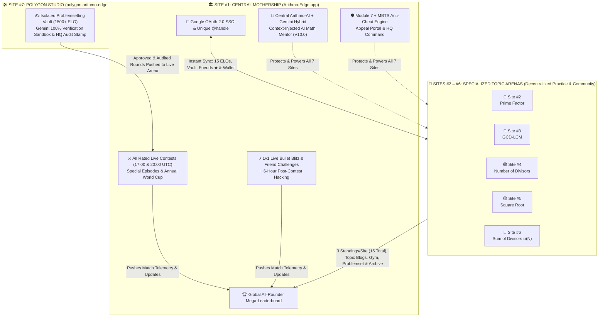
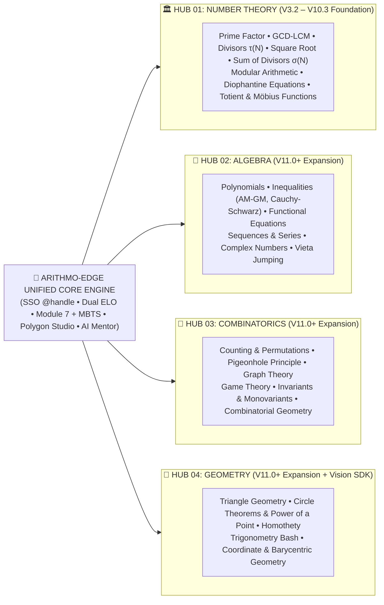

<div align="center">


# 🌌 Prime-Factor.app $\rightarrow$ **Arithmo-Edge**
### *The World's First Real-Time ELO-Rated Competitive Mathematics & Number Theory Mega-Ecosystem*
**Powered by Olympiad Edge**

[](https://github.com/rayaan-tasnim/prime-factor.app)
[](https://arithmo-edge.app)
[](https://firebase.google.com)
[](https://ai.google.dev)
[](#4-zero-false-positive-dual-anti-cheat-module-7--mbts--alt-prevention)
[](https://vercel.com)
[](#)

</div>

---

## 🧭 1. Executive Overview & Core Philosophy

**Prime-Factor.app** is the foundational vanguard of **Arithmo-Edge**—the world’s first real-time, ELO-rated competitive mathematics, mental speed-factorization, and Olympiad number theory arena. Designed as the mathematical counterpart to **Codeforces** and **Chess.com**, the platform transforms pure arithmetic and Olympiad problem-solving into an electrifying, telemetry-verified global e-sport.

Starting as a high-velocity prime factorization engine (`V3.2`–`V3.3`), the architecture scales systematically through `V10.3` into a **7-Site Arithmo-Edge Mothership** and expands in `V11.0+` into the **4 Core International Mathematical Olympiad (IMO) Hubs** (*Number Theory, Algebra, Combinatorics, Geometry*).

### ⚡ Core Engineering & Competitive Pillars

| Pillar | Architectural Standard | Competitive Impact |
| :--- | :--- | :--- |
| **🛡️ Zero False-Positive Fairness** | Dual-layer **Module 7** (Optical/Audio Proctoring with a `4.5s` *Adaptive Gaze Guard*) + **MBTS** (Post-contest behavioral & keystroke telemetry clustering). | Eliminates cheating without ever penalizing honest competitors who look away to think deeply. |
| **⌨️ Zero-Mouse Speed UX** | Desktop hotkeys (`Space` $\rightarrow$ `*`, `Enter` $\rightarrow$ `Submit`) + **Mobile-Only Touch Numpad** (`0–9`, `*`, `^`, `⌫`, `SUBMIT`) + **Zen Focus Mode**. | Removes UI friction and mobile keyboard bounce, letting human calculation speed shine at millisecond precision. |
| **⚔️ 6-Hour Post-Contest Hacking** | Codeforces-style post-contest hacking window (`+25 to +100 pts` for Problem/Edge-Case hacks with Global Rejudge; `+5 to +50 pts` for Opponent hacks). | Crowdsources mathematical rigor, catches AI edge-case flaws, and rewards deep analytical auditing. |
| **💳 Hybrid Fair-Play Monetization** | All daily global rated contests remain **100% Free**. Paid tiers & **Pay-As-You-Go** micro-passes unlock 1v1 Blitz, AI Mentors, and Polygon Hosting. | Ensures zero "Pay-to-Win" advantages while sustaining serverless & AI infrastructure at global scale. |

---

## 🏗️ 2. System Architecture & Ecosystem Diagrams

### 🌐 A. The 7-Site Arithmo-Edge Mothership Architecture (`Post-10.3`)

Rather than cluttering a single domain, **Arithmo-Edge** operates as a **Central Command Mothership** connected via Single Sign-On (`SSO` + unique `@handle`) to **5 Specialized Topic Arenas** and an isolated **Polygon Studio**:



### 🌍 B. V11.0+ Four Core IMO Hubs Mega-Expansion

Once Number Theory reaches full maturity at `V10.3`, the unified core engine clones horizontally across all four pillars of the **International Mathematical Olympiad (IMO)**—expanding into **40–60 specialized sub-arenas** powered by a single `@handle` and shared telemetry engine:



### 📅 Weekly 7-Day Rotational Contest Schedule (`Arithmo-Edge`)

To prevent player fragmentation across sub-arenas, global rated rounds follow a synchronized weekly rotation (with **Expert Mode at `17:00 UTC`** and **General Mode at `20:00 UTC`** every competition day):

```text
┌───────────┬──────────────────────────────────────────┬─────────────────────────────────────────────────────────┐
│    DAY    │               ACTIVE ARENA               │                      FORMAT & RULES                     │
├───────────┼──────────────────────────────────────────┼─────────────────────────────────────────────────────────┤
│ Monday    │ 🔹 Prime Factor                          │ 17:00 UTC Expert (0+ ELO)  |  20:00 UTC General (500+)   │
│ Tuesday   │ 🔸 GCD-LCM                               │ 17:00 UTC Expert (0+ ELO)  |  20:00 UTC General (500+)   │
│ Wednesday │ 🟣 Number of Divisors τ(N)               │ 17:00 UTC Expert (0+ ELO)  |  20:00 UTC General (500+)   │
│ Thursday  │ 🟡 Square Root & Perfect Squares         │ 17:00 UTC Expert (0+ ELO)  |  20:00 UTC General (500+)   │
│ Friday    │ 🌹 Sum of Divisors σ(N)                  │ 17:00 UTC Expert (0+ ELO)  |  20:00 UTC General (500+)   │
│ Saturday  │ 🏆 Special Contest Day (Human-Crafted)   │ 100% Original HQ/Polygon Rounds (IMO Episode, Special)  │
│ Sunday    │ 🛠️ Weekly Rest, Gym & AI Review Day      │ Virtual Gym, Problemset, Blogs & AI Mentor Diagnostics  │
└───────────┴──────────────────────────────────────────┴─────────────────────────────────────────────────────────┘
```

---

## 📚 3. Deep-Dive Architectural Specifications

Click any section below to expand the complete engineering rules, formulas, and operational protocols.

<details>
<summary><strong>⚔️ 1. Dual Live Contests, 8 Segments & 6-Hour Hacking Mechanics</strong></summary>

<br/>

#### 🕒 Daily Synchronized Schedule & Registration
* **Expert Live Contest (`17:00 UTC` / `11:00 PM BST`):** Deep Olympiad number theory and prime-structural problems (`Expert ELO` starts at `0`, floor `0`). Ends by `19:30 UTC`, giving competitors a 30-minute break before the General round.
* **General Live Contest (`20:00 UTC` / `02:00 AM BST`):** High-velocity mental factorization and arithmetic sprint (`General ELO` starts at `500`, floor `0`).
* **1-Minute Registration Cutoff:** One-click registration remains open until `T-1 minute` before kickoff (accompanied by a subtle browser audio cue).
* **Identical Problemsets & Redemption Loop:** Every participant in a segment receives the exact same problemset ordered from easiest to hardest. Each problem can be faced at most **twice**:
  * **General Mode:** `1st Attempt Solve` = `+10 pts` (retired); `Wrong/Skip` $\rightarrow$ `2nd Attempt Solve` = `+5 pts` (`2nd Wrong` = `-5 pts`).
  * **Expert Mode:** Dynamic complexity weights from `+5 pts` to `+40 pts` (`+5 to +100 pts` in Community/Special rounds). Standings remain **hidden** during live Expert rounds to eliminate psychological pressure and collusion.

#### 📊 The 8 Complexity-Based Segments

| Mode | Segment | Tier Name | Questions | Duration | Max Rated ELO Cap | Over-Cap Rule |
| :--- | :--- | :--- | :---: | :---: | :---: | :--- |
| **General** (`20:00 UTC`) | Segment 1 | **Initiate** | 25 | 30 min | `1199 ELO` | Auto-Unrated |
| **General** (`20:00 UTC`) | Segment 2 | **Contender** | 20 | 35 min | `1799 ELO` | Auto-Unrated |
| **General** (`20:00 UTC`) | Segment 3 | **Advanced** | 18 | 45 min | `2399 ELO` | Auto-Unrated |
| **General** (`20:00 UTC`) | Segment 4 | **Finalist** | 15 | 60 min | *Unlimited* | Rated Eligible |
| **Expert** (`17:00 UTC`) | Segment 1 | **Apprentice** | 15 | 75 min | `1199 ELO` | Auto-Unrated |
| **Expert** (`17:00 UTC`) | Segment 2 | **Intermediate** | 12 | 90 min | `1799 ELO` | Auto-Unrated |
| **Expert** (`17:00 UTC`) | Segment 3 | **Vanguard** | 10 | 120 min | `2399 ELO` | Auto-Unrated |
| **Expert** (`17:00 UTC`) | Segment 4 | **Apex** | 8 | 150 min | *Unlimited* | Rated Eligible |

#### 🔥 Discrete ELO Button Firewall
In all **Rated** matches, `Regenerate` is strictly locked regardless of ELO, while tactical lifelines lock progressively as rating climbs:
* `900+ ELO`: **Sandbox** locked | `1200+ ELO`: **Noise** locked | `1400+ ELO`: **Hint** locked | `1800+ ELO`: **Extend** locked | `2400+ ELO`: Only **Skip** active | `3000+ ELO`: **All lifelines locked**. *(In Unrated matches, all tools remain unlocked).*

#### 🧪 Post-Contest 6-Hour Hacking, Recheck Appeals & 7-Hour Finalization (Expert Mode)
1. **Backend Python + Gemini 100% Verification Loop:** Olympiad problems scraped via Python pass a Gemini `'Yes/No'` solvability gate, then enter an isolated Python sandbox cross-check loop until two independent mathematical methods match `100%`. Multi-solution problems are stored as arrays (`[ans1, ans2, ...]`).
2. **6-Hour Hacking Window:**
   * **Problem / Edge-Case Hacking (`+25 to +100 pts` + `+5 to +15 Contribution ELO`):** If a competitor proves the AI judge missed a valid edge case or set an erroneous answer, the problem undergoes a **Global Rejudge**, invalidating all false accepts across the leaderboard.
   * **Opponent Submission Hacking (`+5 to +50 pts` / `-10 pts` Penalty):** Challenging an opponent's vulnerable submission awards `+5 to +50` scoreboard points on success, or deducts `-10` scoreboard points (`-3 to -8 Contribution ELO`) on failed/spam hacks.
3. **"Appeal to Recheck" & Auto-Appeal:** Competitors can trigger `Appeal to Recheck` on any 2nd-attempt failed submission to force-check alternative valid solutions; **Vanguard** and **Apex** segments trigger automatic AI re-audits on high-difficulty misses.
4. **7-Hour Finalization:** `6 Hours Hacking` + `1 Hour MBTS Telemetry Clustering` = Final `Expert ELO` update at `T+7 Hours` (`T+30 Minutes` for General Mode).

</details>

---

<details>
<summary><strong>📈 2. Dual Rating System, 15-ELO Matrix & 30-Day Active Standings</strong></summary>

<br/>

#### 🧮 Tri-Category Rating Architecture & 15-ELO Matrix
Across the 5 Arithmo-Edge arenas, every user holds **15 independent ratings** (`5 Topics × 3 Categories`) plus a unified **Global All-Rounder Index**:
* **`General ELO` (`500` Start | `0` Floor):** Measures raw mental factorization velocity and accuracy.
* **`Expert ELO` (`0` Start | `0` Floor):** Measures deep Olympiad number theory and proof-based problem solving.
* **`Contribution ELO` (`0` Start | Can go Negative `±`):** Measures ecosystem stewardship (Hacking, Polygon Problemsetting, Blogs, Q&A, Bug Reports).

#### 🏅 12-Tier Competitive Rank Titles

| Tier | ELO Range | Prime Factor Title | Arithmo-Edge Archetype |
| :---: | :---: | :--- | :--- |
| **Tier 12** | `0 – 499` | *Unrated / Novice* | Base Radical |
| **Tier 11** | `500 – 799` | *Composite Apprentice* | Euclidean Initiate |
| **Tier 10** | `800 – 999` | *Factor Seeker* | Modular Voyager |
| **Tier 09** | `1000 – 1199` | *Sieve Calibrator* | Divisor Analyst |
| **Tier 08** | `1200 – 1399` | *Coprime Tactician* | Congruence Specialist |
| **Tier 07** | `1400 – 1599` | *Totient Strategist* | Diophantine Vector |
| **Tier 06** | `1600 – 1799` | *Quadratic Arbiter* | Residue Master |
| **Tier 05** | `1800 – 1999` | *Gaussian Cryptographer* | Analytic Theorist |
| **Tier 04** | `2000 – 2199` | *Riemann Vanguard* | Grand Theorist |
| **Tier 03** | `2200 – 2399` | *Eulerian Grandmaster* | International Master |
| **Tier 02** | `2400 – 2999` | *Dirichlet Sovereign* | Legendary Grandmaster |
| **Tier 01** | `3000+` | *Prime Singularity* | The Absolute Infinity |

#### 🌍 Real-Time Standings & System Expectation ELO Override
* **30-Day Active Match Filter:** Global leaderboards stream live via Firestore `onSnapshot` and display active competitors who have played at least **1 rated match in the last 30 days**. Inactive users retain their ELO safely and reappear immediately upon playing a match.
* **Pinned "Your Standing" Card & Star (`★`) Friends:** Logged-in users always see their exact global rank pinned at the top via `getCountFromServer()`. Starring (`★`) any profile adds them to the **`My Friends`** leaderboard filter alongside **Country** and **Institution/Club** filters.
* **System Expectation Override (`ΔR` Formula):**
  $$\Delta R = K \times (\text{Actual Score} - \text{Expected Score}) \times \text{Velocity Factor}$$
  If a `1200 ELO` player faces a `2200 ELO` Grandmaster and loses narrowly (`9/10` vs `10/10` with high speed), exceeding the system's expected score still rewards the underdog with **positive ELO (`+ΔR`)**! Conversely, sluggish/sloppy wins against far weaker opponents can yield slight rating adjustments.

</details>

---

<details>
<summary><strong>⚡ 3. 1v1 Live Bullet Blitz & Dual Challenge Engine</strong></summary>

<br/>

#### 🎯 Dual Matchmaking Modes (`V6.2` & `V7.5`)
1. **Random Global Pool (`±100 ELO` Queue):** Instant rated 1v1 matchmaking pairing opponents within `±100 ELO` on identical problemsets and synchronized millisecond timers (*General Bullet*: 10 problems / 2 min; *Expert Blitz*: 5 problems / 15 min). Ties break by fastest completion millisecond.
2. **Direct Friend Challenge (`@handle` & Shareable Invite Link):**
   * Challenge any rival directly by typing their `@handle` (triggers a real-time HUD alert) or generate a shareable room link (`arithmo-edge.app/duel?room=XYZ123`) for WhatsApp, Discord, or Messenger.
   * Supports **1v1 Duels** and **2–10 Player Multiplayer / Team Rooms** (where Peak ELO averages calibrate question difficulty, and each participant individually selects **Rated** or **Unrated**).

#### ⏳ 30-Minute Expiration & Global Pool Fallback
* **Paid to Create, Free to Accept:** Creating a live 1v1 or multiplayer challenge requires an active subscription or a single `$0.29` Duel Token, whereas **accepting any challenge is 100% free** for all users.
* **Global Pool Fallback:** Unaccepted direct challenges auto-expire after **30 minutes**. If an invited friend is offline, the challenger can click **`Convert to Global Pool Match?`** to seamlessly route their custom room into the global matchmaking queue.

</details>

---

<details>
<summary><strong>🛡️ 4. Zero False-Positive Dual Anti-Cheat (`Module 7` + `MBTS`) & Alt Prevention</strong></summary>

<br/>

#### 🎥 Layer 1: `Module 7` — Optical Telemetry & Neural Audio Collusion Trap
* **Site-Wide Hardware Consent Gate:** Rated arenas require active Camera and Microphone permissions (`getUserMedia`). Denying permissions blocks rated entry.
* **Context-Aware Adaptive Gaze Guard (`4.5s` Buffer):** Standard eye-gaze deflection grace (`2.0s`) automatically expands to **`4.5 seconds`** whenever a competitor faces complex composite numbers ($N \ge 3$ prime factors) or pauses typing to think mentally—preventing false flags during genuine cognitive calculation. Instant `-5 ELO` + lockdown triggers only on hard violations (leaving seat, covering lens, pitch-black room, or smartphone screen reflection detected in pupils while typing).
* **3-Axis Neural Audio Collusion Trap:** Flags external voice assistance **only** when three independent signals fire simultaneously:
  1. External voice phoneme matches a prime factor/number, **AND**
  2. Eye-gaze vector drops off-screen toward a secondary device, **AND**
  3. Exact answer is typed in `100ms–2500ms` with **zero backspaces**.

#### 🧠 Layer 2: `MBTS` — Measure of Behavioral & Telemetry Similarity
* Runs post-contest (`30 min` for General, `60 min` post-hacking for Expert). Ignores trivial numbers and clusters only high-complexity problems—comparing shared identical wrong factorizations, factor entry sequences, inter-keystroke cadence intervals, and network telemetry.
* **Team Contest Exemption:** In official Team Rounds (`2–10` members sharing a single input field), `MBTS` treats the roster as a unified cognitive unit.

#### 🪜 11-Flag Blackhole Lockdown Ladder & Alt-Account Prevention
* **Blackhole Lockdown Ladder:**
  * `Flags 1–2`: Next **1** positive-ELO contest (`ΔR > 0`) is nullified to `0 ELO`.
  * `Flags 3–8`: Next **2** positive-ELO contests nullified to `0 ELO`.
  * `Flag 9`: Next **3** positive-ELO contests nullified to `0 ELO`.
  * `Flag 10`: Mandatory **1-Month Temporary Ban** + hardware security reset.
  * `Flag 11`: **Permanent Gmail & IP Ban** across all 7 Arithmo-Edge sites.
* **4-Signal Alt / Self-Upvote Neutralization:** Detects sockpuppet accounts upvoting user blogs or throwing matches via IP/subnet correlation, device fingerprint, cross-account keystroke cadence, and reciprocal vote graphs—**silently neutralizing** illegitimate `Contribution ELO` without alerting bad actors.
* **4-Step Forensic Appeal & 7-Day Post-Ban Portal:** Banned users retain login access exclusively to the **`Appeal`** hub for **7 days** to submit evidence to the **Chief Arbiter**, who reviews telemetry logs, gaze vectors, and keystroke replays before ruling.

</details>

---

<details>
<summary><strong>💎 5. Hybrid Monetization, Pay-As-You-Go Wallet & Contribution Rewards</strong></summary>

<br/>

#### 💳 5-Tier Monthly Subscriptions *(Strict One-Time 7-Day Free Trial per UID/Card)*

| Tier | Price / Mo | V10.0 AI Math Mentor Quota | 1v1 Live Blitz Limit | Key Exclusive Capabilities |
| :--- | :---: | :--- | :--- | :--- |
| **Free** | `$0.00` | `5` questions/mo *(High Latency)* | Locked *(Accepts Free)* | **100% Free Daily Live Contests**, Gym, Problemset, Blogs, Appeals |
| **Plus** | `$2.99` | `30` questions/mo *(Standard)* | `3` matches/day | Ad-free UX, `Plus` Badge, `5` Virtual Contests/mo, `100` Vault slots |
| **Pro** | `$5.99` | `150` questions/mo *(Low Latency)* | `10` matches/day | Unlimited Virtual Contests, `5`-Player Friend Rooms, Weekly AI Diagnostics |
| **Premium** | `$9.99` | `500` questions/mo *(Ultra-Fast)* | `30` matches/day | **Polygon Contest Hosting (`1500+ ELO`)**, `10`-Player Rooms, Paid Episodes |
| **Singularity** | `$14.99` | **Unlimited** *(Zero-Latency)* | **Unlimited** *(Priority)* | **Unlocks All 5 Arithmo-Edge Sites**, Custom Themes, Fast-Track Appeals |
| **Academy** | `$29.99` | `2,000` shared pool *(Low Latency)* | `100` shared/day | **Up to 100-Student Team Contests**, Inter-Club Championships, Coach Dashboard |

#### 🪙 Pay-As-You-Go One-Time Micro-Passes & Arithmo Wallet (`walletCredits`)
Users can top up their server-verified **Arithmo Wallet** or purchase standalone passes with zero recurring billing—and even **gift passes** to friends via `@handle`:
* **Single Challenge Token (`$0.29`):** 1 rated 1v1 Bullet Blitz or Direct Challenge room.
* **24-Hour Unlimited Duel Pass (`$0.99`):** Unlimited 1v1 & friend challenges for 24 hours.
* **AI Mentor Mini / Mega Packs (`$0.99` for 25 Qs | `$2.49` for 100 Qs):** Non-expiring AI tutor credits.
* **Single Contest Host Pass (`$1.49`) / Multiplayer Team Pass (`$0.79`):** One-off Polygon hosting or 10-player room access.
* **Deep Diagnostic Report (`$0.49`) / Smart Mistake Deck (`$0.69`):** Post-contest AI heatmaps & 50-card spaced-repetition decks.
* **Single School/Club Tournament Pass (`$4.99`):** Host a 100-student championship event without a monthly Academy plan.

#### 🏆 Earn Everything Free via `Contribution ELO` & Blog-to-Lab Pipeline
* **Merit-Based Wallet Rewards:** Every `+50 Contribution ELO` unlocks `2` Duel Tokens + `10` AI Mentor Qs; `+100 ELO` unlocks a `24h` Duel Pass + `25` AI Qs; `+250 ELO` unlocks a free Contest Host Pass; `+500 ELO` grants **1 Month of Premium (`$9.99`) Free**.
* **AI-Curated Blog-to-Lab Pipeline:** Gemini + Arithmo-AI continuously shortlist the highest-rigor community blogs into a *"Lab Candidate Queue"*. Upon Headquarters approval, the article is permanently published to `edu.html` and `archive.html` with permanent author credit and a **`+5 Contribution ELO`** bonus.
* **QR-Verified Certificate Portal (`/verify`):** World Cup finalists, Special Episode winners, and `3000+ ELO` *Prime Singularities* receive cryptographically signed certificates verifiable by universities and sponsors via QR code.

</details>

---

<details>
<summary><strong>🧭 6. 6-Card Unified Hub Navigation & 24-Node Architecture</strong></summary>

<br/>

To keep the interface clutter-free while housing 24 deep modules, the entire platform is organized into **6 Unified Hub Cards** with fixed **Signature Dark Neon Themes** (no light-mode toggle) and an in-match **Zen Focus Mode** toggle:

| Hub Card | Hub File | Included Platform Nodes (24 Total) |
| :--- | :--- | :--- |
| **01 \| ARENA & COMPETITION** | `arena-hub.html` | `01` Gateway (`index.html`), `06` Live Contest & Exam Engine (`contest.html`, `exam.html`), `16` 1v1 Blitz & Duels (`duel.html`), `17` Contest Gym (`gym.html`), `08` Division Ranges (`ranges.html`, `custom.html`) |
| **02 \| PROBLEMSET & LABS** | `training-hub.html` | `18` Olympiad Problemset (`problemset.html`), `04` Education Lab (`edu.html`), `21` Theorem & Editorial Archive (`archive.html`), `19` Polygon Studio (`workshop.html`) |
| **03 \| STANDINGS & COMMUNITY** | `community-hub.html` | `15` Global Live Standings (`leaderboard.html`), `20` Community Blog & Expert Q&A (`blog.html`, `qa.html`), `03` 12-Tier ELO Matrix (`rating.html`), `09` Hall of Medals (`medals.html`) |
| **04 \| AI MENTOR & DIAGNOSTICS** | `intelligence-hub.html` | `24` Context-Injected AI Math Mentor (`mentor.html`), `14` Telemetry Diagnostics Matrix (`cognitive-matrix.html`), `05` Laboratory Services (`services.html`) |
| **05 \| IDENTITY & GOVERNANCE** | `governance-hub.html` | `07` Candidate Profile (`profile.html`), `22` Handle Direct Messages (`messages.html`), `10` Notification Center (`notifications.html`), `11 & 13` Engine & Profile Settings, `02 & 12` Rules & FAQ, `23` 6-Segment Appeal Portal (`appeal.html`) |
| **06 \| UPGRADE PLAN** | `pricing-hub.html` | Direct comparison of Free, 5 Paid Tiers (`Plus`–`Academy`), 7-Day Trial activation, Pay-As-You-Go micro-passes, and Arithmo Wallet top-ups |

#### 🎨 Signature Sub-Site Color Identity
* **Prime Factor:** `Electric Cyan (#00F0FF)` | **GCD-LCM:** `Mint Emerald (#10B981)` | **Number of Divisors:** `Vibrant Violet (#8B5CF6)` | **Square Root:** `Laser Amber (#F59E0B)` | **Sum of Divisors $\sigma(N)$:** `Nebula Rose (#F43F5E)`

</details>

---

<details>
<summary><strong>🗺️ 7. Complete Master Version Roadmap (<code>V3.2</code> through <code>V11.0+</code>)</strong></summary>

<br/>

* **✅ `V3.2 – V3.3` (Foundation & Cloud Genesis — Live):** Client-side Brent-Pollard's Rho & Miller-Rabin engine, `Space = *` / `Enter = Submit` zero-mouse hotkeys, Firebase Auth (Google OAuth 2.0) + Cloud Firestore migration, Season 2 `500 ELO` baseline.
* **🚀 `V3.4 – V3.8` (Identity, Focus & Pre-Flight):** Real-time Top 100 Global Standings (30-day active filter), pinned personal rank, unique `@handle`, Star (`★`) Friends, public profiles (`?handle=...`), **Zen Focus Mode**, Mobile Touch Numpad, ELO Progression Graph, public SVG badges, Offline PWA sandbox, Digital Rough Canvas, and 10s Hardware Pre-Flight Check.
* **⚔️ `V4.0 – V4.5` (General Live Arena & Dual Anti-Cheat):** Daily `20:00 UTC` General Live Contests (4 segments), Button Firewall, **Module 7** (`4.5s` Adaptive Gaze Guard + 3-Axis Audio Trap), **MBTS** 30-min post-contest verification, Solve-Time Heatmaps, Match Replay, and Country/Institution filters.
* **🏛️ `V5.0 – V5.5` (Expert Olympiad Mode & 6-Hour Hacking):** Daily `17:00 UTC` Expert Live Contests, Dual ELO (`General 500+` vs `Expert 0+`), Python scraping + Gemini 100% verification sandbox loop, **6-Hour Hacking + Global Rejudge**, `Appeal to Recheck` & Auto-Appeal, `@handle` Inbox, 6-Segment Appeal Portal, Contest Gym, and Problemset.
* **🛠️ `V6.0 – V6.5` (Polygon Studio, Monetization & Team Contests):** Isolated **Polygon Studio** (`1500+ ELO` + 6 clean matches), `Contribution ELO (0±)`, 5-tier subscriptions + 7-day trial + Pay-As-You-Go Wallet, Dual Challenge System (30-min Global Pool Fallback), Virtual Contests, Shared-Input Team Contests, and Daily POTD Streaks.
* **📖 `V7.0 – V7.5` (Knowledge Hub & 1v1 Bullet Blitz):** LaTeX Community Blog with pre-post Gemini zero-tolerance moderation, `2000+ ELO` Expert Q&A Hub, AI-verified Training Arena expansion, `My Vault`, AI Appeal Triage, and **1v1 Live Bullet Blitz Matchmaking**.
* **🧠 `V8.0 – V8.4` (Hybrid Arithmo-AI & 6-Card Hub):** Fine-tuned **Arithmo-AI + Gemini Hybrid** (sub-millisecond MBTS & pre-filtering), TTL caching cost optimization, and consolidation of 24 nodes into 6 Unified Hub Pages.
* **👑 `V9.0 – V9.3` (5-Tier Headquarters & Special Episodes):** Merit-invited (`200+ Contribution ELO`) 5-tier Headquarters hierarchy (*Core Sentinel* $\rightarrow$ *Problem Architect* $\rightarrow$ *Round Coordinator* $\rightarrow$ *Chief Arbiter* $\rightarrow$ top 3 Flag-Immune *Prime Sovereigns*, with free-user reporting accountability on lower tiers), Special Episodes (*IMO Episode, Arithmo Special, Olympiad Challenge, Math Query*), and Inter-Club Championships.
* **🤖 `V10.0` (Context-Injected Interactive AI Math Mentor):** Single major release introducing a Socratic & step-by-step AI Math Mentor pre-loaded with the user's 15 ELOs, deficit bases, and last 10 match telemetry logs (hard-locked during live contests).
* **🏆 `V10.1 – V10.3` (World Cup, Push PWA & Mistake Deck):**
  * `V10.1`: **Annual World Cup** (`Top 128` General & Expert) using a 6-round **Progressive Half-Elimination** bracket (`128 → 64 → 32 → 16 → 8 → 4 → Champion`), awarding permanent rotating Golden Crowns (`👑`), Lifetime Singularity Passes, and sponsor prizes.
  * `V10.2`: Offline-first installable PWA with `T-15 min` contest push notifications.
  * `V10.3`: **AI Smart Mistake Deck** generating 7-day spaced-repetition flashcards from contest misses.
* **🌌 `Post-10.3` & `V11.0+` (Arithmo-Edge & 4 Core IMO Hubs):** Full 7-site Arithmo-Edge launch followed by horizontal expansion across **Number Theory, Algebra, Combinatorics, and Geometry** (`40–60` specialized arenas).

</details>

---

## ⚙️ 4. Tech Stack, Zero-Cost Scaling & Repository Setup

### 🛠️ Production Architecture & Zero-Cost Scaling Strategy

By executing factorization engines, audio synthesizers, and optical proctoring directly in the client browser (`Client-Side Edge Computing`) and leveraging edge caching + atomic batch writes, the platform supports **50,000+ concurrent free users** at near-zero baseline infrastructure cost:

| Layer | Technology / Service | Architectural Role & Cost Guardrail |
| :--- | :--- | :--- |
| **Frontend & Engine** | `Vite` + `Vanilla ES6+` + `KaTeX` + `Web Audio API` | Sub-50ms load time, Pollard's Rho + Miller-Rabin client engine, tactile velocity decay audio. |
| **Hosting & Edge Proxy** | `Vercel Edge` / `GitHub Pages` + `Cloudflare Workers` | Secures `GEMINI_API_KEY` & payment webhooks server-side (`100,000` free requests/day). |
| **Auth & Database** | `Firebase Auth (Google OAuth 2.0)` + `Cloud Firestore` | Single atomic match writes, `getCountFromServer()` rank queries, TTL local caching, `$5` hard budget cap. |
| **Security & Bot Defense** | `Firestore Security Rules` + `Firebase App Check` + `Turnstile` | Prevents DevTools score spoofing, API scraping, and bot spam on blogs/appeals. |
| **AI & Automated Jobs** | `Gemini SDK` + `Arithmo-AI` + `GitHub Actions (Python)` | Free scheduled cron jobs for Olympiad scraping, 100% sandbox verification, and `MBTS` runs. |
| **Payments & Webhooks** | `Lemon Squeezy` / `Paddle` (Merchant of Record) | Zero monthly fee; cryptographic webhooks securely credit `subscriptionTier` & `walletCredits`. |

### 🚀 Local Development & Deployment Guide

```bash
# 1. Clone the repository
git clone https://github.com/rayaantasnim/Prime-Factorization-Web.git
cd Prime-Factorization-Web

# 2. Install dependencies
npm install

# 3. Configure environment variables (.env.local)
cat <<EOF > .env.local
VITE_FIREBASE_API_KEY=your_firebase_api_key
VITE_FIREBASE_AUTH_DOMAIN=your_project.firebaseapp.com
VITE_FIREBASE_PROJECT_ID=your_project_id
VITE_FIREBASE_APP_CHECK_SITE_KEY=your_turnstile_or_recaptcha_key
GEMINI_API_KEY=your_server_side_gemini_key
LEMON_SQUEEZY_WEBHOOK_SECRET=your_webhook_secret
EOF

# 4. Run local Vite development server
npm run dev

# 5. Deploy Firestore security rules & serverless edge functions
firebase deploy --only firestore:rules
vercel --prod
```

<div align="center">

---

**Authorized by Rayaan Tasnim**  
&copy; All Rights Reserved  
&copy; Arithmo-Edge  
*Powered by Olympiad Edge*

</div>